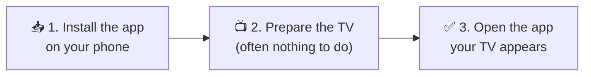

# 📺 TV Remote

### Your phone becomes a fast, beautiful remote for **any** Android TV.

No IP typing · Many TVs · Instant response · Liquid glass design

 

📱 For your <b>phone</b> · Free · ~90 KB · Android 5.0 and newer · <a href="https://github.com/mbnetworku/Android-TV-remote-application./releases">all versions</a>

  

📺 For your <b>TV</b>, only if it has no Google TV pairing and you don't want to turn on debugging. See Step 2.

  

[How it works](TECHNICAL.md) · [Security](SECURITY.md) · [Terms of Use](TERMS.md)

> [!IMPORTANT]
> **Free forever · No ads · No tracking**
>
> By downloading or using TV Remote you agree to the **[Terms of Use](TERMS.md)**:
> - 🚫 **Do not clone** or copy this repository or its code.
> - 🚫 **Do not reverse-engineer**, decompile or modify the app.
> - 🚫 **Do not re-upload, sell or rebrand** the APK. Share the official link instead.
>
> © 2026 mbnetworku. All rights reserved.

---

## 🤔 What is it?

TV Remote turns your phone into a remote control for your Android TV or TV box over Wi-Fi.
It works on **every** Android TV, **with or without developer options**, and picks the best way to connect by itself:

| Your TV | How it connects | Developer options? |
|---|---|---|
| 🟢 Google-certified Android TV / Google TV (Sony, TCL, Philips, Xiaomi, Chromecast, Shield…) | **Google TV pairing**: type the code shown on the TV | ❌ Not needed |
| 🟢 Any Android TV or box (Realtek, Amlogic, MBOX…) | **TV Receiver app**: install once, type the PIN shown on the TV | ❌ Not needed |
| 🟢 Any Android TV with debugging on | **Network debugging**: fastest, full features | ✅ Needed |

> 💡 **Lost your remote? Batteries dead?** Just open the app.

---

## ✨ Why you'll love it

<table>
<tr>
<td width="50%">

### 🔎 Finds your TV by itself
Open the app and every TV on your Wi-Fi shows up. **No IP addresses to type.**

</td>
<td width="50%">

### 👆 Swipe between TVs
Living room, bedroom, kitchen… save them all and **swipe the TV name** to switch.

</td>
</tr>
<tr>
<td>

### ⚡ Instant response
Key presses arrive in about **16 ms**, close to a real remote.

</td>
<td>

### ⭐ Favorite apps with real icons
Pick any app installed on your TV. It shows with its **real icon**, one tap opens it.

</td>
</tr>
<tr>
<td>

### ⌨️ Real keyboard
Type searches and passwords with your **phone keyboard**.

</td>
<td>

### 🖐️ Touchpad or D-pad
Swipe like a laptop touchpad, or use the classic round D-pad.

</td>
</tr>
<tr>
<td>

### 🔊 See the TV volume
The remote shows the **TV volume in %**. Tap it for a slider, or use **+ / −** and your phone's volume buttons.

</td>
<td>

### 🔒 100% private
No account, no internet, no ads, no tracking. Everything stays on your Wi-Fi.

</td>
</tr>
</table>

---

## 🚀 Get started in 3 steps

<b>📥 Step 1: Install the app</b> (click to open)

 

1. On your phone, tap **[⬇️ Download APK](https://github.com/mbnetworku/Android-TV-remote-application./releases/latest/download/TVRemote.apk)**. The download starts straight away.
2. Open the downloaded file. If Android asks, allow **"Install unknown apps"**.

Needs **Android 5.0** or newer.

<b>📺 Step 2: Prepare your TV</b> (one time only)

 

Make sure the TV and phone use the **same Wi-Fi**, then pick **one** of these:

**🅰️ Google TV / certified Android TV: nothing to install**
Skip to Step 3. The phone shows a box for the 6-character code your TV displays.

**🅱️ Any other TV or box: install the TV Receiver (no developer options)**
1. Get **[TVRemote-Receiver.apk](https://github.com/mbnetworku/Android-TV-remote-application./releases/latest/download/TVRemote-Receiver.apk)** onto the TV, with a USB stick or the free **Downloader** app.
2. Open **TV Remote Receiver** on the TV and press **Open Accessibility settings**.
3. Switch **TV Remote Receiver** **ON**.

**🅲 Or: turn on network debugging (fastest, full features)**
1. On the TV open **Settings → Device Preferences → About**.
2. Click **Build** 7 times until you see *"You are now a developer"*.
3. Go back to **Developer options** and turn on **USB debugging** / **Network debugging**.

<b>✅ Step 3: Connect</b>

 

1. Open **TV Remote**. It searches your Wi-Fi and lists your TVs.
2. The first time, the TV shows one of these:
   - a **6-character code** (Google TV): type it on the phone;
   - a **4-digit PIN** (TV Receiver): type it on the phone;
   - **"Allow debugging?"**: tick **Always allow** and press **Allow**.
3. Done. The dot next to the TV name turns 🟢 green.

---

## 🎮 How to use it

| You do this | It does this |
|---|---|
| 👉 **Swipe** the TV name | Switch to your next TV |
| 👆 **Tap** the TV name | See all TVs · switch · remove · scan · add by IP |
| ⭕ **D-pad** | Move · hold to repeat · hold **OK** for options |
| ▢ **Touchpad button** | Switch between D-pad and touchpad |
| ▦ **Apps** | Open any app · **hold** an app to add it to ★ favorites |
| ★ **Favorite** | Opens that app · hold to remove |
| ⌨️ **Keyboard** | Types on the TV while you type on the phone |
| 🔊 **VOL %** label | Tap for a volume slider |
| 🎚️ **Settings button** | Turn vibration and tick sound on or off |

**Status dots:** 🟢 connected · 🟠 connecting · ⚪ offline

---

## ❓ Questions

<b>My TV doesn't show up</b>

 

- If it isn't a Google TV, make sure the **TV Receiver** is switched on, or **network debugging** is on (Step 2).
- Check that the phone and TV are on the **same Wi-Fi** (not a guest network).
- Tap the TV name → **Scan**, or type the TV's IP (TV: *Settings → Network → About*).

<b>Is it safe?</b>

 

The app talks only to your TV on your home Wi-Fi. It has no internet features, ads or tracking. Your TV asks you to approve the phone first.
Read [SECURITY.md](SECURITY.md) for details.

<b>Does it work with Google TV / Chromecast / Sony / TCL / Xiaomi?</b>

 

Yes. It works with any Android TV or Google TV device that has network (ADB) debugging. Fire TV sticks work too (*Settings → My Fire TV → Developer options → ADB debugging*).

<b>Some keys like Input or Channel do nothing</b>

 

That depends on the TV. Not every TV supports every key.

---

## 📚 More

| Document | What's inside |
|---|---|
| 🛠️ [TECHNICAL.md](TECHNICAL.md) | Architecture and how it works inside |
| 🔒 [SECURITY.md](SECURITY.md) | Privacy, permissions and how to report problems |
| 📜 [TERMS.md](TERMS.md) | Terms of Use: free, no ads, no cloning, no reverse engineering |
| ⚖️ [LICENSE](LICENSE) | Legal license |

---

### ⚖️ License

**This is proprietary software. © 2026 mbnetworku. All rights reserved.**

✅ You may download and use the app on your own devices. 
❌ You may **not** copy, modify, fork for reuse, or redistribute the code or the APK.

See [LICENSE](LICENSE).

